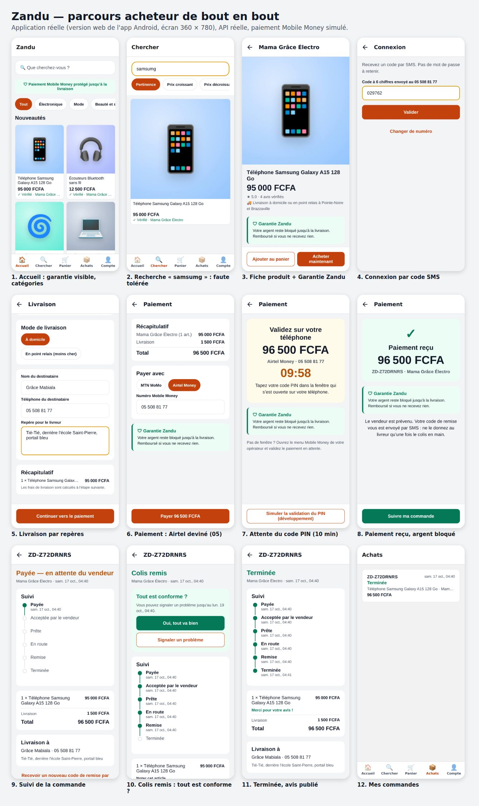
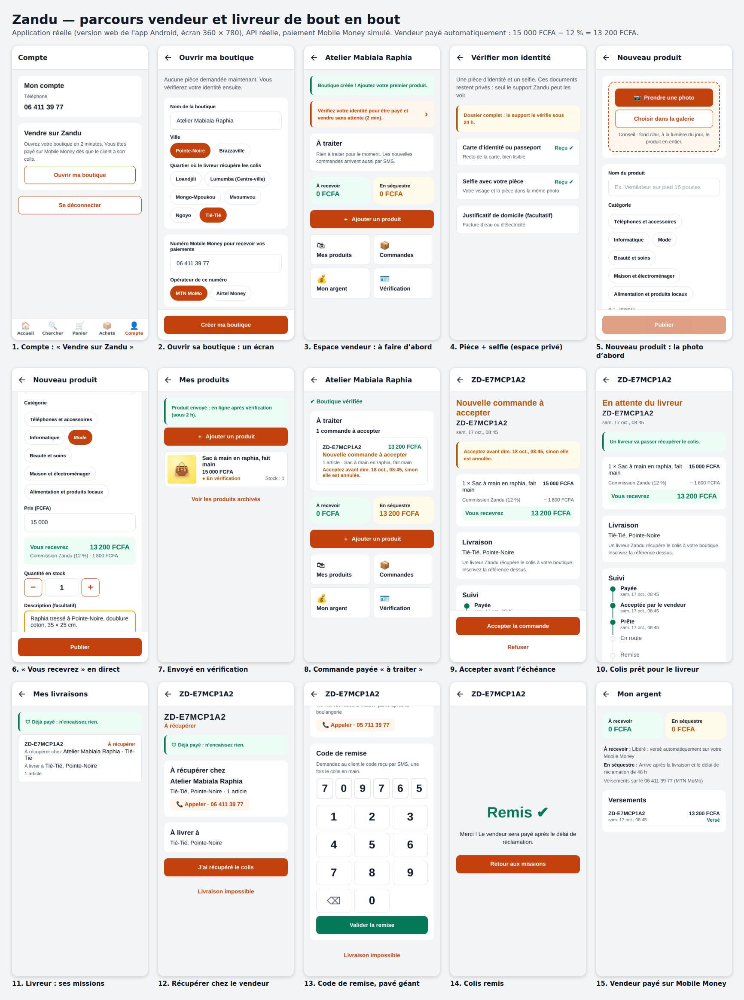
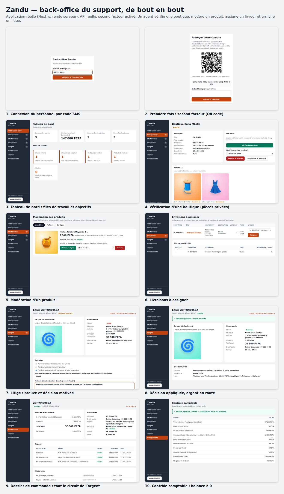
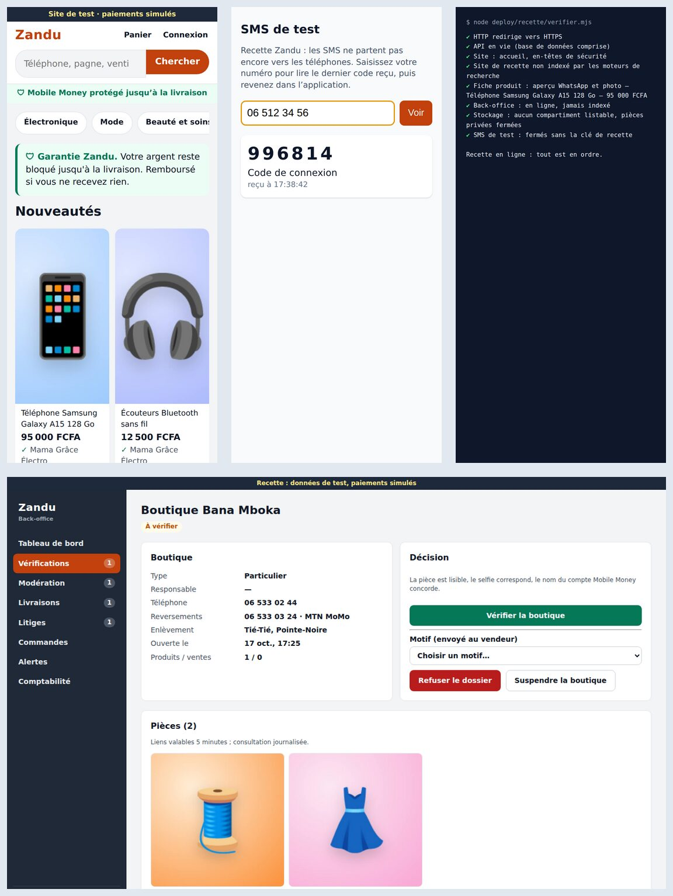

# Zandu

**La place de marché congolaise où l'on achète et vend en confiance, payé par Mobile Money.**

_Zandu_ signifie « marché » en kikongo (_zando_ en lingala). Les vendeurs publient leurs produits, les acheteurs paient avec
MTN MoMo ou Airtel Money, et **l'argent reste bloqué en séquestre jusqu'à la livraison** : le vendeur
est payé quand le client a son colis, l'acheteur est remboursé s'il ne l'a pas.
Lancement prévu à Pointe-Noire, puis Brazzaville et la zone CEMAC.

## État du projet

- **Base de données complète** (PostgreSQL 16) avec garde-fous en base : grand livre en partie double
  en écriture seule, équilibre vérifié à chaque transaction, transitions de commande verrouillées.
- **Règles métier pures** (`packages/domain`) : argent en FCFA entiers, commissions, machines à états
  commande et paiement, écritures comptables, plafonds des nouveaux vendeurs, filtre de messagerie.
- **API** (`apps/api`) : connexion par SMS, catalogue et recherche, panier multi-vendeurs, paiement Mobile
  Money (simulateur d'agrégateur), séquestre, livraison avec code de remise, litiges, remboursements,
  reversements automatiques, espace vendeur, photos et pièces KYC par URL signées, avis, back-office.
- **Application Android** (`apps/mobile`, Expo) : les trois métiers.
  - Acheteur : de l'accueil à l'avis.
  - Vendeur : ouvrir sa boutique, vérifier son identité, publier un produit « photo d'abord »,
    traiter les commandes, suivre son argent.
  - Livreur : ses missions et la remise contre le code de l'acheteur.
- **Site web acheteurs** (`apps/web`, Next.js) : un produit partagé sur WhatsApp s'affiche avec sa
  photo et son prix, et s'achète sans installer l'application (Mobile Money, suivi, réception).
- **Back-office du support** (`apps/backoffice`, Next.js) : vérification des boutiques, modération,
  assignation des livreurs, litiges, recherche de commandes, alertes, contrôle comptable ; connexion
  avec **second facteur obligatoire** (application d'authentification).
- **Prêt à mettre en ligne** (`Dockerfile`, `deploy/recette/`) : une image par service, une recette
  complète sur un seul serveur avec HTTPS automatique, paiements simulés et SMS de test protégés par
  mot de passe, APK Android de recette construit par GitHub Actions. Guide :
  [mettre la recette en ligne](docs/exploitation/mise-en-ligne-recette.md).
- **157 tests automatiques** (dont tous les cas d'erreur de paiement du cahier des charges et un test de
  contrat OpenAPI), quatre parcours de bout en bout pilotés dans un navigateur, et un essai complet de
  la recette en conteneurs à chaque pull request.










À construire : branchement de l'agrégateur réel et du fournisseur SMS/WhatsApp,
commissions et rapports dans le back-office, miniatures d'images, rapprochement quotidien. Voir la
[feuille de route](docs/produit/feuille-de-route-16-semaines.md).

## Documentation

Tout est dans [`docs/`](docs/README.md) : architecture, décisions (ADR), expérience utilisateur,
feuille de route, décisions à prendre, contrat d'API.

## Démarrage rapide

```bash
pnpm install
docker compose up -d
cp .env.example .env && export $(grep -v '^#' .env | xargs)
pnpm db:migrate && pnpm db:seed
pnpm test            # 157 tests
pnpm dev:api         # http://localhost:3000/health
```

Détails : [guide du développeur](docs/developpement.md).

## Structure

```
apps/api/          API HTTP + worker (Node.js, Fastify)
apps/mobile/       Application Android : acheteur, vendeur, livreur (React Native, Expo)
apps/web/          Site web acheteurs (Next.js, rendu serveur, aperçus WhatsApp)
apps/backoffice/   Back-office du support (Next.js, rendu serveur)
packages/domain/   Règles métier pures (argent, statuts, grand livre)
packages/api-client/  Client typé généré depuis le contrat OpenAPI
db/migrations/     Schéma SQL versionné
db/seeds/          Données de référence (zones, tarifs, catégories, commissions)
deploy/recette/    Recette sur un serveur : Docker Compose, Caddy, vérifications, sauvegardes
Dockerfile         Images de l'API, du site web et du back-office
docs/              Dossier d'architecture
```
