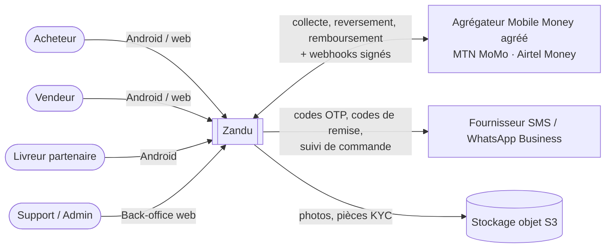
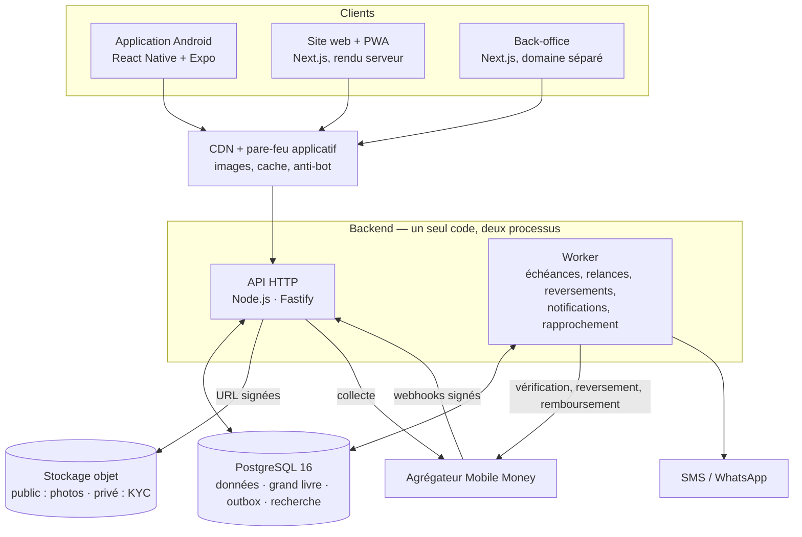

# 1. Vue d'ensemble de l'architecture

> Public : fondateur, développeurs, prestataires qui chiffrent le projet.
> Statut : **v1 — proposée par l'architecte**, à valider par le fondateur (voir [décisions à prendre](../produit/decisions-a-prendre.md)).

## 1.1 Ce que l'architecture doit garantir

Zandu vend une promesse simple : **« Achetez et vendez en confiance, payé par Mobile Money. »**
Toute l'architecture découle de trois exigences, dans cet ordre :

1. **L'argent ne se perd jamais et ne bouge jamais deux fois.** Séquestre, reversement, remboursement : chaque franc est tracé dans un grand livre en partie double, vérifié par la base de données elle-même.
2. **Ça marche sur un Android d'entrée de gamme en 3G.** Page catalogue en moins de 3 s, application de moins de 30 Mo (cible : 15 Mo), mode dégradé hors ligne.
3. **Deux développeurs peuvent le construire en 16 semaines et le faire tourner seuls.** Pas de complexité inutile : un seul langage, une seule base, un seul déploiement backend.

## 1.2 Dix principes d'architecture

| #   | Principe                                                 | Conséquence concrète                                                                                                              |
| --- | -------------------------------------------------------- | --------------------------------------------------------------------------------------------------------------------------------- |
| P1  | **Aucune règle d'argent dans les applications**          | Les apps affichent ; l'API décide. Les règles vivent dans `packages/domain`, testées sans base ni réseau.                         |
| P2  | **Deux verrous indépendants sur ce qui est critique**    | Transitions de commande vérifiées par le code ET par un trigger SQL ; équilibre comptable vérifié par le code ET au COMMIT.       |
| P3  | **Tout est idempotent**                                  | Clé `Idempotency-Key` côté client, référence unique côté agrégateur, clé métier unique côté grand livre.                          |
| P4  | **On n'appelle jamais l'agrégateur en tenant un verrou** | Appel réseau hors transaction ; une issue inconnue est _vérifiée_ avant toute nouvelle tentative.                                 |
| P5  | **Les échéances vivent dans les données**                | `expires_at`, `seller_accept_deadline`, `dispute_window_ends_at` en colonnes + balayeurs idempotents. Pas de minuteur en mémoire. |
| P6  | **Ennuyeux et éprouvé**                                  | PostgreSQL, Node.js, HTTP/JSON. Pas de Kafka, pas de Kubernetes, pas de microservices au MVP.                                     |
| P7  | **Monolithe modulaire, frontières nettes**               | Un déploiement, des modules qui ne se parlent que par des fonctions de service. Découpable plus tard (ADR-0001).                  |
| P8  | **Adaptateurs remplaçables**                             | Agrégateur, SMS/WhatsApp, stockage : derrière des interfaces. Changer de fournisseur = un fichier.                                |
| P9  | **Léger par défaut**                                     | Rendu serveur, images WebP/AVIF dimensionnées, données compressées, budget de poids par écran.                                    |
| P10 | **Observable dès le premier jour**                       | Journaux structurés, balance comptable exposée, alertes sur taux de paiement, écarts de rapprochement, litiges.                   |

## 1.3 Contexte : qui parle au système

## 1.4 Conteneurs : comment c'est découpé

- **API et worker partagent le même code** (`apps/api`) : `main.ts` sert le HTTP, `worker.ts` exécute les tâches de fond. On les met à l'échelle séparément.
- **PostgreSQL est la seule source de vérité** : commandes, grand livre, file de messages sortants (outbox), recherche plein texte. Une seule base à sauvegarder, à restaurer, à surveiller (ADR-0003).
- **Le back-office est une application distincte** sur un domaine distinct (surface d'attaque réduite, accès restreint, double authentification).

## 1.5 Choix technologiques

| Couche               | Choix                                               | Pourquoi (détail dans les ADR)                                                                             |
| -------------------- | --------------------------------------------------- | ---------------------------------------------------------------------------------------------------------- |
| Langage              | **TypeScript partout**                              | Une équipe de 2 : chacun peut corriger n'importe quelle couche ; types et validations partagés (ADR-0002). |
| Backend              | **Node.js 22 + Fastify 5**, SQL explicite (`pg`)    | Rapide, simple, SQL lisible pour l'argent ; pas d'ORM qui cache les verrous (ADR-0001).                    |
| Base                 | **PostgreSQL 16**                                   | Transactions, contraintes, triggers, recherche française, `SKIP LOCKED` pour les files (ADR-0003).         |
| Android              | **React Native + Expo** (Hermes)                    | Mises à jour à distance sans re-télécharger l'APK, code partagé avec le web (ADR-0007).                    |
| Web acheteur/vendeur | **Next.js** (rendu serveur, PWA)                    | Aperçus de liens WhatsApp/Facebook, référencement, premier affichage rapide en 3G (ADR-0006).              |
| Back-office          | **Next.js + kit d'admin** (ex. Refine, React-Admin) | Écrans de listes/formulaires générés : des semaines économisées.                                           |
| Paiement             | **Agrégateur agréé** derrière un port               | Pas d'agrément à obtenir au départ ; changement d'agrégateur sans toucher au séquestre (ADR-0004).         |
| Tâches de fond       | **Échéances en base + balayeurs + outbox**          | Pas de Redis ni de file externe au MVP (ADR-0009).                                                         |
| Hébergement          | **Conteneurs Docker**, Postgres managé avec PITR    | Portable entre hébergeurs ; région choisie sur mesure de latence (ADR-0010).                               |

> **Écart assumé avec le cahier des charges.** Le cahier suggère Flutter pour Android _et_ web. Je recommande
> Flutter **non** pour le web : un site Flutter se dessine dans un canevas, pèse plusieurs Mo au premier
> chargement et ne produit pas d'aperçu de lien exploitable sur WhatsApp — or le partage WhatsApp est le
> premier canal d'acquisition du business plan. Voir ADR-0002, 0006 et 0007.

## 1.6 Ce qui est déjà construit dans ce dépôt

| Élément                                                                                                                                                                                                                                                                                        | Où                                                                                                                                         | État                                                                                                                                                               |
| ---------------------------------------------------------------------------------------------------------------------------------------------------------------------------------------------------------------------------------------------------------------------------------------------- | ------------------------------------------------------------------------------------------------------------------------------------------ | ------------------------------------------------------------------------------------------------------------------------------------------------------------------ |
| Schéma complet du MVP (41 tables)                                                                                                                                                                                                                                                              | `db/migrations/`                                                                                                                           | ✅ validé sur PostgreSQL 16                                                                                                                                        |
| Règles métier pures (argent, commission, statuts, comptabilité, reversements, filtre messagerie)                                                                                                                                                                                               | `packages/domain`                                                                                                                          | ✅ 71 tests                                                                                                                                                        |
| API : OTP (+ TOTP du personnel), catalogue/recherche, checkout multi-vendeurs, paiement + séquestre, livraison avec code, litiges, reversements, remboursements, espace vendeur, missions livreur, photos et pièces KYC (URL signées), avis, files du support, recherche de commandes, alertes | `apps/api`                                                                                                                                 | ✅ 80 tests d'intégration, dont un test de contrat OpenAPI                                                                                                         |
| Simulateur d'agrégateur (cas d'erreur du cahier §5)                                                                                                                                                                                                                                            | `apps/api/src/modules/payments/simulator.ts`                                                                                               | ✅                                                                                                                                                                 |
| Client d'API typé, généré depuis le contrat                                                                                                                                                                                                                                                    | `packages/api-client`                                                                                                                      | ✅ vérifié en CI                                                                                                                                                   |
| Application Android — parcours acheteur, vendeur (boutique, KYC, produit « photo d'abord », commandes, argent) et livreur (missions, code de remise)                                                                                                                                           | `apps/mobile`                                                                                                                              | ✅ deux parcours de bout en bout automatisés ([acheteur](../ux/captures/parcours-acheteur.jpg), [vendeur et livreur](../ux/captures/parcours-vendeur-livreur.jpg)) |
| Back-office du support (vérifications, modération, livraisons, litiges, commandes, alertes, comptabilité)                                                                                                                                                                                      | `apps/backoffice`                                                                                                                          | ✅ parcours de bout en bout automatisé ([captures](../ux/captures/back-office.jpg))                                                                                |
| Site web acheteurs : catalogue, fiches avec aperçu WhatsApp (Open Graph), vitrines de boutique, achat complet sans application                                                                                                                                                                 | `apps/web`                                                                                                                                 | ✅ parcours de bout en bout + budget 3G vérifié ([captures](../ux/captures/site-web.jpg))                                                                          |
| Paquet de mise en ligne : images Docker, recette sur un serveur (HTTPS, stockage S3, SMS de test protégés), APK de recette                                                                                                                                                                     | ✅ recette démarrée en HTTPS et contrôlée ; parcours site web et support passés dessus ([guide](../exploitation/mise-en-ligne-recette.md)) |
| Photos déclinées par le worker : vignette, fiche, partage WhatsApp ; métadonnées supprimées                                                                                                                                                                                                    | ✅ accueil 5,2 Mo → 358 Ko en 3G avec de vraies photos ([ADR-0014](../adr/0014-declinaisons-des-photos.md))                                |
| Rapports du mois, export CSV comptable, taux de commission modifiables (administrateurs)                                                                                                                                                                                                       | ✅ parcours de bout en bout ([captures](../ux/captures/rapports.jpg))                                                                      |
| Adaptateur de l'agrégateur réel, SMS/WhatsApp réel, rapprochement quotidien                                                                                                                                                                                                                    | —                                                                                                                                          | ⏳ à construire                                                                                                                                                    |

Voir la [feuille de route](../produit/feuille-de-route-16-semaines.md) pour le reste à faire, semaine par semaine.
