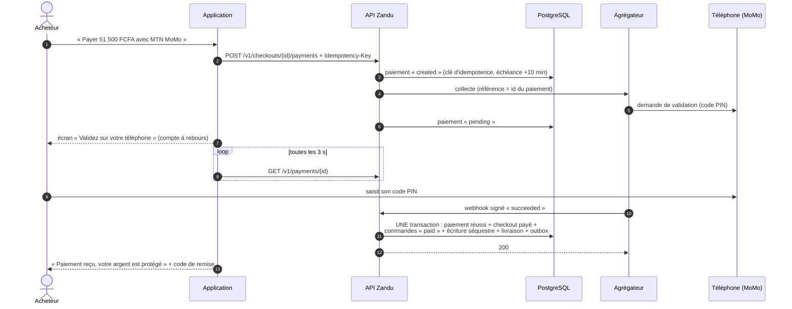
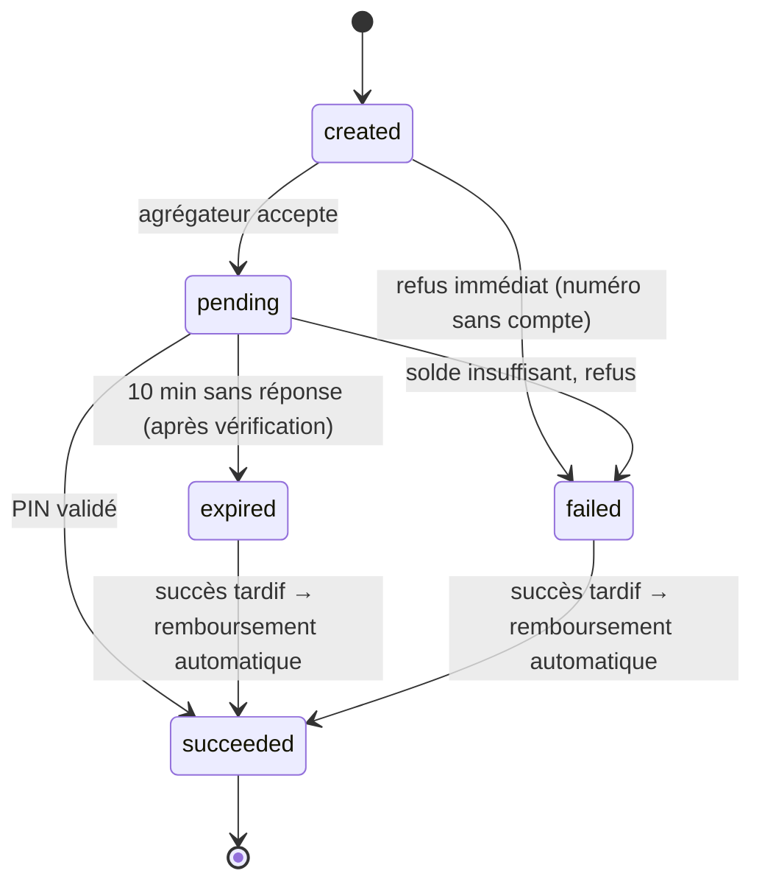
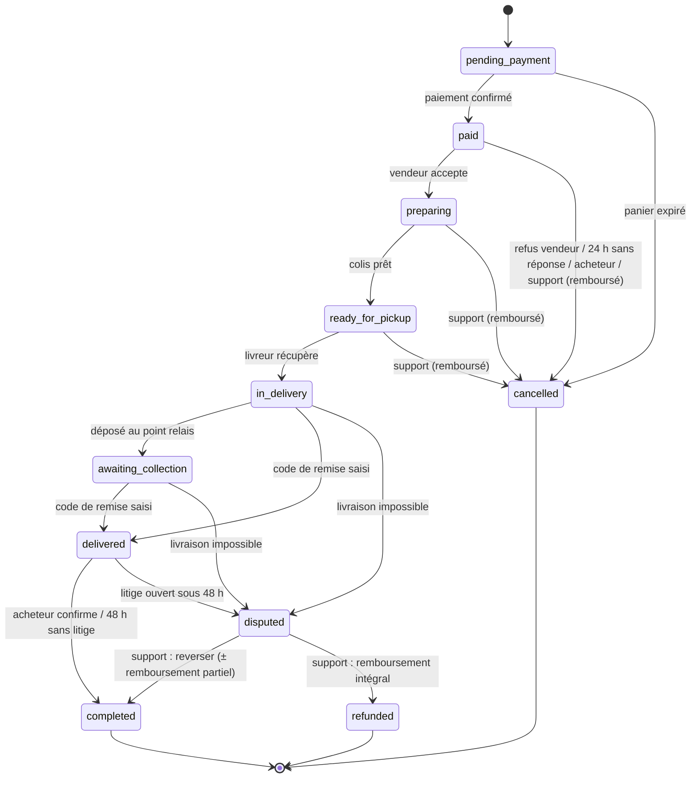

# 3. Paiement Mobile Money, séquestre et grand livre

> C'est la partie **la plus risquée** du projet (cahier §8) et celle qui fait la valeur de Zandu.
> Elle est construite et testée dans ce dépôt ; il reste à brancher l'agrégateur réel.

## 3.1 Le séquestre, en une phrase

**La plateforme ne touche pas l'argent : l'agrégateur agréé le détient. Zandu tient le registre
de « à qui il appartient » à chaque instant, et ne donne l'ordre de le verser qu'au bon moment.**

Le séquestre est donc une _règle de statuts_ (cahier §5) matérialisée par un compte comptable
`liability:escrow`, ventilé commande par commande.

## 3.2 Parcours d'un paiement

Si le webhook se perd, le worker **interroge l'agrégateur** toutes les 2 min pendant 30 min (étapes 9-11
remplacées par un `lookup`). Les deux chemins appellent la même fonction `applyCollectionSignal`.

## 3.3 Machines à états

### Paiement (une ligne par tentative)

Un checkout peut avoir plusieurs tentatives (changement d'opérateur), mais **au plus une en cours et au
plus une réussie effective** — garanti par deux index uniques partiels en base.

### Commande (une par vendeur)

Source : `packages/domain/src/order-machine.ts`. La même liste est inscrite dans la table SQL
`order_status_transitions` ; un trigger refuse toute autre transition, et un test vérifie que les deux
listes sont identiques.

## 3.4 Grand livre en partie double

Chaque mouvement d'argent est une **transaction** dont les lignes somment à zéro (débit > 0, crédit < 0).
La base refuse au `COMMIT` toute transaction déséquilibrée ou à une seule ligne, et refuse toute
modification ou suppression (`UPDATE`, `DELETE`, `TRUNCATE`). On corrige par une écriture inverse.

| Compte                             | Nature  | Signification                                          |
| ---------------------------------- | ------- | ------------------------------------------------------ |
| `asset:provider_cash:<agrégateur>` | actif   | Argent réellement détenu chez l'agrégateur             |
| `liability:escrow`                 | passif  | Séquestre : argent des acheteurs, ventilé par commande |
| `liability:seller_payable:<id>`    | passif  | Solde disponible du vendeur                            |
| `liability:courier_payable:<id>`   | passif  | Dû au partenaire de livraison                          |
| `liability:refunds_in_transit`     | passif  | Remboursements décidés, pas encore confirmés           |
| `liability:payouts_in_transit`     | passif  | Reversements envoyés, pas encore confirmés             |
| `liability:suspense`               | passif  | Paiements tardifs à rembourser                         |
| `revenue:commission`               | produit | Commission de la plateforme                            |
| `revenue:delivery_margin`          | produit | Marge sur la livraison                                 |
| `expense:payment_fees`             | charge  | Frais de l'agrégateur                                  |

### Exemple chiffré (celui du business plan)

Article 50 000 FCFA, commission 10 %, livraison 1 500 FCFA dont 1 300 au livreur.

| Étape                        | Écriture                                                                                                            |
| ---------------------------- | ------------------------------------------------------------------------------------------------------------------- |
| Paiement confirmé            | agrégateur **+51 500** · séquestre (commande) **−51 500**                                                           |
| Commande terminée            | séquestre **+51 500** · vendeur **−45 000** · commission **−5 000** · livreur **−1 300** · marge livraison **−200** |
| Reversement réservé          | vendeur **+45 000** · reversements en cours **−45 000**                                                             |
| Reversement confirmé         | reversements en cours **+45 000** · agrégateur **−45 000**                                                          |
| Frais agrégateur (ex. 2,5 %) | frais **+1 288** · agrégateur **−1 288**                                                                            |

Reste chez l'agrégateur : 6 500 − frais = commission + livraison (dont 1 300 dus au livreur). Ce scénario
est exactement le test `purchase-flow.test.ts`.

**Remboursement partiel** (litige, 10 000 FCFA) : la commission est réduite au prorata des articles
conservés (5 000 × 40 000 / 50 000 = 4 000) ; le livreur reste payé ; le vendeur reçoit 36 000.

**Idempotence comptable** : chaque transaction porte une clé métier unique (`capture:<paiement>`,
`release:<commande>`, `payout_reserve:<reversement>`…). Rejouer un webhook ou relancer une tâche ne
peut pas créer une seconde écriture.

## 3.5 Règles de robustesse du cahier §5 — et où elles sont prouvées

| Exigence / cas d'erreur                                  | Mécanisme                                                                              | Test                                                    |
| -------------------------------------------------------- | -------------------------------------------------------------------------------------- | ------------------------------------------------------- |
| Clé d'idempotence : un double appel ne débite pas 2 fois | Table `idempotency_keys` + `UNIQUE (buyer_id, idempotency_key)` + référence agrégateur | `payment-failures` « double appel »                     |
| Webhooks vérifiés et rejouables                          | Signature HMAC + horodatage ±5 min ; `provider_events UNIQUE(provider, event_id)`      | « signature invalide », `purchase-flow` (rejeu)         |
| Paiement sans confirmation sous 10 min → annulé          | `payments.expires_at` + balayeur, **dernière vérification** auprès de l'agrégateur     | « PIN non validé », « succès juste avant l'expiration » |
| PIN non validé → stock libéré                            | Effet `restock` de la transition `checkout_expired`                                    | « PIN non validé »                                      |
| Solde insuffisant → réessayer / changer d'opérateur      | Tentative `failed` + message clair ; nouvelle tentative sur le même checkout           | « solde insuffisant »                                   |
| Webhook perdu → interrogation 2 min / 30 min             | `next_poll_at`, `poll_until`, balayeur `pollPayments`                                  | « webhook perdu »                                       |
| Échec du reversement → retry puis alerte                 | Moteur `disbursements` : 3 tentatives (5 min, 30 min), puis écriture inverse + alerte  | « échec du reversement »                                |
| Colis non livré → remboursement intégral                 | `delivery_failed` → litige → `refund_full`                                             | `disputes-and-trust` « colis non livré »                |
| Montants en entiers FCFA                                 | `bigint` partout ; parseur `pg` qui refuse les entiers non exacts ; `money.ts`         | `money.test.ts`, 2 000 commandes aléatoires             |
| Plafond des nouveaux vendeurs (30 jours)                 | `payout-policy.ts` : 150 000 FCFA / 24 h (paramétrable)                                | `payout-policy.test.ts`                                 |
| Rapprochement quotidien                                  | Tables `reconciliation_*` prêtes ; tâche à écrire avec l'API de relevé de l'agrégateur | ⏳                                                      |

Cas supplémentaires traités (non listés au cahier mais réels sur le terrain) :

- **Succès tardif** : l'acheteur valide le PIN après l'expiration. L'argent est arrivé, la commande n'existe
  plus → capture en compte d'attente + **remboursement automatique** + alerte support.
- **Issue inconnue** (timeout réseau pendant un reversement) : l'opération passe en `processing` et est
  **vérifiée** auprès de l'agrégateur avant toute nouvelle tentative. Jamais de double reversement.
- **Contradiction de l'agrégateur** (échec annoncé après un succès comptabilisé) : rien n'est modifié,
  alerte au support.
- **Vendeur silencieux** : 24 h sans acceptation → annulation, remise en stock, remboursement.

## 3.6 Brancher l'agrégateur réel

L'interface à implémenter est `PaymentProvider` (`apps/api/src/modules/payments/provider.ts`) :
`initiateCollection`, `initiatePayout`, `initiateRefund`, `lookup`, `parseWebhook`. Le simulateur est
l'implémentation de référence.

**Questions à poser aux agrégateurs** (pawaPay et CinetPay annoncent tous deux le Congo-Brazzaville ;
à vérifier contractuellement) :

1. Agrément BEAC/COBAC et détention des fonds : qui détient l'argent entre collecte et reversement ?
2. MTN MoMo **et** Airtel Money au Congo, en collecte, reversement **et** remboursement ?
3. Idempotence : notre référence est-elle une clé unique ? Peut-on la réutiliser après un échec ?
4. Webhooks : signés comment ? rejoués combien de fois ? API de consultation de statut ?
5. Frais (collecte, reversement), plafonds par transaction et par jour, délai de règlement.
6. API de relevé quotidien (pour le rapprochement) et format.
7. Bac à sable (sandbox) disponible **avant la semaine 6** (jalon du cahier).

> Si l'agrégateur interdit de réutiliser une référence après un échec, l'adaptateur dérive une référence
> par tentative (`<id>-<n°>`) et interroge la précédente avant d'en créer une nouvelle.

## 3.7 Rapprochement quotidien (à construire, semaines 11-12)

Chaque nuit, pour chaque agrégateur : télécharger le relevé J-1, apparier chaque ligne avec
`payments` / `payouts` / `refunds` par référence, comparer montants et statuts, et comparer le solde de
`asset:provider_cash:<agrégateur>` au solde annoncé. Tout écart crée une ligne
`reconciliation_discrepancies` et une alerte. Critère de recette : **aucun écart après 7 jours**.
