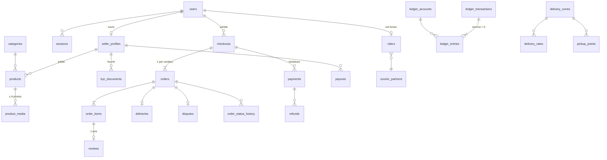

# 4. Modèle de données

Source de vérité : [`db/migrations/0001_init.sql`](../../db/migrations/0001_init.sql) (40 tables, commentées).
Il reprend les 14 tables du cahier des charges (§6) et ajoute ce qu'exige la robustesse.

## 4.1 Vue d'ensemble

## 4.2 Ce qui a été ajouté au modèle du cahier, et pourquoi

| Ajout                                                                             | Raison                                                                                                                                                |
| --------------------------------------------------------------------------------- | ----------------------------------------------------------------------------------------------------------------------------------------------------- |
| `checkouts`                                                                       | Un paiement pour un panier multi-vendeurs, découpé en une commande par vendeur (ADR-0011).                                                            |
| `order_status_transitions` + trigger                                              | Second verrou sur les transitions (en plus du code).                                                                                                  |
| `order_status_history`                                                            | Historique complet affiché à l'acheteur et au support ; preuve en cas de litige.                                                                      |
| `ledger_accounts`, `ledger_transactions`                                          | Partie double : comptes nommés, transactions équilibrées et idempotentes.                                                                             |
| `refunds`                                                                         | Remboursements suivis comme les reversements (tentatives, statut, alerte).                                                                            |
| `provider_events`                                                                 | Boîte de réception des webhooks : dédoublonnage, rejeu, preuve.                                                                                       |
| `idempotency_keys`                                                                | Idempotence de toutes les requêtes sensibles (checkout, paiement).                                                                                    |
| `outbox_events`, `notifications`                                                  | Aucune notification perdue ni envoyée pour une transaction annulée.                                                                                   |
| `commission_rules`                                                                | Commission par défaut / catégorie / vendeur, datée (offre de lancement à 0 %).                                                                        |
| `delivery_zones`, `delivery_rates`, `pickup_points`, `courier_partners`, `riders` | F10 : tarifs par zone, points relais, livreurs.                                                                                                       |
| `otp_challenges`, `sessions`, `user_mfa`                                          | F1 et second facteur du personnel : secret TOTP chiffré, dernier pas utilisé (anti-rejeu) ; `sessions.mfa_verified_at` ouvre les routes du personnel. |
| `reconciliation_runs`, `reconciliation_discrepancies`, `provider_statement_lines` | Rapprochement quotidien (ADR-0015) : un contrôle par agrégateur et par jour, écarts identifiés une seule fois, relevés conservés tels que reçus.      |
| schéma `simulator`                                                                | Comptes propres de l'agrégateur simulé (développement, tests, recette) ; vide et inutilisé en production.                                             |

## 4.3 Conventions

- **Argent** : `bigint`, francs CFA entiers. Colonne `currency char(3) DEFAULT 'XAF'` présente dès
  maintenant : les six pays de la CEMAC partagent le XAF, l'expansion régionale ne demande donc pas de
  multi-devises (seulement la RDC, en CDF, en demanderait).
- **Instantanés** : prix, titre et taux de commission sont copiés dans `order_items` ; l'adresse dans
  `orders.shipping_address`. Modifier un produit ne modifie jamais une commande passée.
- **Adresses par repères** : `landmark` (« Tié-Tié, derrière l'école Saint-Pierre, portail bleu ») plutôt
  qu'un numéro de rue, + zone de livraison structurée. Coordonnées GPS en V2.
- **Téléphones** : format international E.164 (`+242061234567`, le 0 congolais est conservé).
- **Horodatages** : `timestamptz` UTC ; affichage en heure de Brazzaville (UTC+1, sans heure d'été).
  Les règles de délai lisent l'heure de l'application (horloge injectable), jamais `now()` SQL.
- **Identifiants** : UUID ; référence publique de commande lisible au téléphone (`ZD-7K3M9Q2P`,
  alphabet sans I/L/O/U pour éviter les confusions).
- **Écriture seule** : `ledger_*`, `order_status_history`, `audit_logs` (UPDATE/DELETE/TRUNCATE refusés).

## 4.4 Évolutions prévues

| Version | Migration                                    | Contenu                                             |
| ------- | -------------------------------------------- | --------------------------------------------------- |
| MVP     | `0002_reviews_api`… (au fil des sprints)     | Index complémentaires selon les requêtes réelles    |
| V2      | `product_variants`, `order_items.variant_id` | Tailles/couleurs (F5)                               |
| V2      | `promotions`, `coupons`                      | Codes promo, ventes flash                           |
| V2      | `deliveries.tracking_points`                 | Suivi GPS du livreur                                |
| V2      | `affiliates`, `referrals`                    | Parrainage et programme ambassadeurs                |
| V2      | `subscriptions`, `ads_campaigns`             | Abonnements vendeurs premium, annonces sponsorisées |

Règle : une migration déjà appliquée en production n'est **jamais** modifiée ; on en ajoute une nouvelle.
