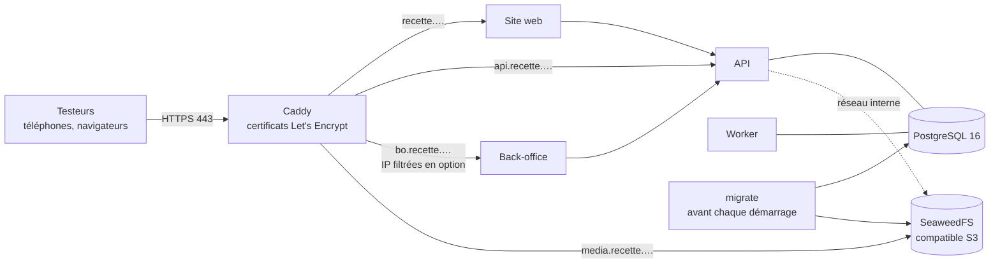
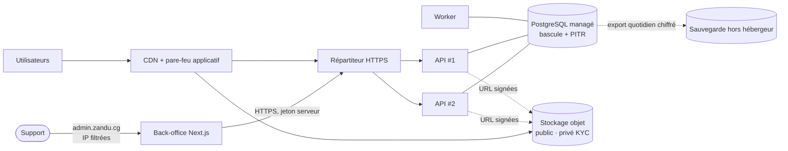

# 7. Infrastructure, déploiement et montée en charge

## 7.1 Environnements

| Environnement | `ZANDU_ENV`   | Rôle                                                  | Agrégateur                                 | Données                         |
| ------------- | ------------- | ----------------------------------------------------- | ------------------------------------------ | ------------------------------- |
| Local         | `development` | Développement (`docker compose up`)                   | Simulateur                                 | Données de référence + essais   |
| Recette       | `recette`     | Téléphones réels, démo fondateur, bêta fermée, charge | Simulateur, puis **bac à sable** réel (D1) | Démonstration + essais testeurs |
| Production    | `production`  | Public                                                | Production                                 | Réelles                         |

Le simulateur est **refusé au démarrage** en production (`config.ts`). La recette applique les règles
de la production (S3, CORS explicites, second facteur, journaux `info`) ; ses SMS restent dans une
boîte de réception protégée par `RECETTE_KEY` tant qu'aucun fournisseur n'est branché (ADR-0013).

## 7.1 bis Recette : un seul serveur (ADR-0013, `deploy/recette/`)

- Mêmes images qu'en production (`Dockerfile`, cibles `api`, `web`, `backoffice`) ; seuls 80 et 443
  sont ouverts. Serveur conseillé : 2 vCPU, 4 Go, 40 Go.
- La tâche `migrate` applique les migrations, charge les données de référence et vérifie le stockage
  (compartiment privé illisible sans signature) ; l'API ne démarre qu'après elle.
- Mise en ligne pas à pas, sauvegardes, mises à jour : [guide](../exploitation/mise-en-ligne-recette.md).

## 7.2 Topologie de production (MVP)

- **2 instances API** (1 vCPU / 1 Go chacune suffisent largement à 100 commandes/h) ;
- **1 worker** (peut passer à 2 : les balayeurs utilisent `FOR UPDATE SKIP LOCKED`) ;
- **1 instance du site web** (image `web`) derrière le CDN, variables `ZANDU_API_URL` et `SITE_URL`
  (adresse publique, utilisée dans les aperçus WhatsApp, lue au démarrage) ;
- **1 instance back-office** (image `backoffice`) sur un domaine distinct, filtré par IP ou VPN,
  variable `ZANDU_API_URL` vers l'API ;
- **PostgreSQL managé** avec bascule automatique et restauration à la minute près (PITR) ;
- **Stockage objet** compatible S3 : compartiment public derrière le CDN (photos), compartiment privé (KYC) ;
- Migrations appliquées par une étape de déploiement (`node dist/db/migrate.js` dans l'image `api`),
  verrou consultatif anti-concurrence ; puis `node dist/cli/check-storage.js`.

## 7.3 Choix de l'hébergeur et de la région (ADR-0010)

La latence depuis Pointe-Noire dépend du chemin des câbles sous-marins (WACS, 2Africa) : une région
européenne peut être **plus proche** qu'une région sud-africaine. Décision **sur mesure**, pas sur carte :

1. Depuis Pointe-Noire, sur MTN et Airtel en 3G/4G, mesurer la latence (p50/p95) vers 3-4 régions
   candidates (ex. Paris, Francfort, Johannesburg, Le Cap, Lagos).
2. Garder les régions à p95 < 250 ms ; vérifier la conformité (transfert de données, loi 29-2019).
3. Choisir l'offre la plus simple à opérer pour deux développeurs (PaaS conteneurs + Postgres managé).

Tant que la décision n'est pas prise, rien ne nous lie : images Docker standard, PostgreSQL standard,
API S3 standard. Supabase peut servir de **Postgres managé + stockage** si on le retient, sans y
déplacer la logique de paiement.

## 7.4 Budget d'infrastructure indicatif (MVP)

| Poste                                   | Mois (ordre de grandeur, à confirmer par devis) |
| --------------------------------------- | ----------------------------------------------- |
| 2 instances API + 1 worker              | 25 000 – 60 000 FCFA                            |
| PostgreSQL managé avec PITR             | 20 000 – 60 000 FCFA                            |
| Stockage objet + CDN                    | 5 000 – 20 000 FCFA                             |
| Supervision / erreurs                   | 0 – 20 000 FCFA                                 |
| **Sous-total technique**                | **≈ 50 000 – 160 000 FCFA**                     |
| SMS (OTP + codes de remise) et WhatsApp | variable : ≈ 2 SMS par commande + connexions    |

Cohérent avec les 6 M FCFA « technologie et hébergement » de l'année 1 du business plan. Le poste
**SMS/WhatsApp** est le plus variable : le négocier avec le fournisseur et privilégier WhatsApp pour
tout ce qui n'est pas un code.

## 7.5 Intégration et déploiement continus

- **À chaque envoi, sur toute branche, et à chaque pull request** (GitHub Actions, `.github/workflows/ci.yml`) : formatage,
  typage, 71 tests unitaires, 89 tests d'intégration contre un vrai PostgreSQL 16, compilation,
  validation du contrat OpenAPI, compilation Android ; en parallèle, construction des trois images et
  **démarrage de toute la recette en conteneurs** (`deploy/recette/essai-local.sh`) avec ses contrôles.
- **Déploiement** : fusion sur `main` → déploiement automatique en recette ; étiquette `vX.Y.Z` →
  production après validation. Migrations avant le basculement du code (toujours rétrocompatibles).
- **Application Android** : en recette, APK construit à la demande par GitHub Actions
  (`apk-recette.yml`, sans compte Expo) ; en production, builds EAS signés avec une clé dédiée, mises à
  jour JavaScript à distance (EAS Update) pour corriger sans republier ; nouvelle version Play Store
  seulement quand le code natif change.

## 7.6 Montée en charge : quand faire quoi

| Palier                          | Signal                            | Action                                                                    |
| ------------------------------- | --------------------------------- | ------------------------------------------------------------------------- |
| Lancement Pointe-Noire          | 5 000 utilisateurs/jour           | Topologie ci-dessus. Rien de plus.                                        |
| Brazzaville (mois 12-18)        | p95 API > 300 ms, CPU base > 60 % | Réplique en lecture pour le catalogue ; cache CDN des fiches produit      |
| 50 000+ produits actifs         | Recherche > 200 ms                | Moteur de recherche dédié (Meilisearch / Typesense) alimenté par l'outbox |
| CEMAC                           | Équipe > 6 développeurs           | Extraire `payments` + `ledger` en service séparé (frontière déjà nette)   |
| Volumes élevés de notifications | Outbox > 100 événements/s         | File externe (ex. Redis Streams / SQS) derrière la même interface         |
