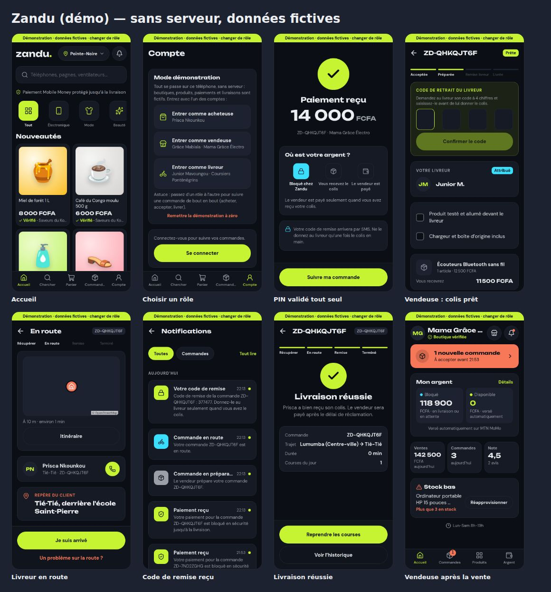

# Démonstration locale : l'application sans serveur

Version de l'application **« Zandu (démo) »** qui fonctionne entièrement sur le téléphone, avec
des données fictives : aucun serveur, aucune base, aucun vrai paiement, aucun SMS. Elle sert à
montrer et essayer les parcours (acheteur, vendeur, livreur) partout, même sans réseau.

Elle s'installe à côté des autres versions (identifiant Android `cg.zandu.app.demo`).



## Ce qu'on y trouve

- Les **3 boutiques et 12 produits** de démonstration (photos intégrées), les catégories,
  quartiers, points relais, tarifs de livraison et commissions de la vraie plateforme.
- Un historique déjà en place : une commande terminée et notée, une commande à accepter chez
  Mama Grâce Électro, un colis prêt que le livreur doit venir chercher.
- Trois comptes, accessibles d'un toucher depuis **Mon compte → Mode démonstration** (ou le
  bandeau vert en haut de chaque écran) :
  - acheteuse **Prisca Nkounkou** ;
  - vendeuse **Grâce Mabiala**, boutique Mama Grâce Électro ;
  - livreur **Junior Mavoungou**, Coursiers Ponténégrins.
- Tout autre numéro saisi à la connexion crée un compte acheteur ; le code s'affiche avec
  « Afficher le code (démonstration) ».

## Suivre une commande de bout en bout

1. **Acheteuse** : choisir un produit de Mama Grâce Électro, « Acheter maintenant », adresse,
   payer. Le « PIN Mobile Money » se valide tout seul au bout de 5 secondes (un numéro qui finit
   par 99 est refusé, comme en recette).
2. **Vendeuse** : la commande apparaît au tableau de bord ; l'accepter, puis « Colis prêt ».
3. **Livreur** : la course apparaît (pas de support en démonstration : elle lui est confiée
   d'office). Il montre son **code de retrait**.
4. **Vendeuse** : saisir ce code dans la commande.
5. **Livreur** : cocher les vérifications, « J'ai le colis », puis « Je suis arrivé ».
6. **Acheteuse** : le **code de remise** est dans ses notifications (cloche).
7. **Livreur** : saisir ce code sur le pavé : livraison réussie.
8. **Acheteuse** : « Tout est conforme », noter. La vendeuse voit l'argent reversé.

« Remettre la démonstration à zéro » (Mon compte) revient aux données de départ.

## Limites

- Les données restent sur le téléphone ; elles ne sont pas partagées entre téléphones.
- La carte du livreur a besoin d'internet pour ses fonds de carte (le reste fonctionne sans
  réseau).
- Pas de support ni de back-office : attribution des courses, vérification des pièces
  d'identité (acceptées au bout de 15 secondes) et litiges sont simplifiés.
- Les photos prises par une vendeuse restent dans le cache du téléphone : elles peuvent
  disparaître si Android le vide.

## Comment c'est fait

- `packages/demo` (`@zandu/demo`) : une API fictive en TypeScript, sans dépendance au serveur,
  qui répond aux mêmes routes et avec les mêmes formes que la vraie API. Elle réutilise les règles
  de `@zandu/domain` (commissions, numéros congolais, distances).
- `apps/mobile/src/demo.ts` : avec `EXPO_PUBLIC_DEMO=1`, les appels de l'application à l'API sont
  traités par `@zandu/demo` dans le téléphone ; l'état est enregistré dans le stockage local.
- `apps/api/test/demo-contract.test.ts` : chaque réponse de la démonstration est validée contre
  le contrat `docs/api/openapi.yaml`, comme celles de la vraie API. Si le contrat change, la CI
  signale la démonstration à mettre à jour.
- `apps/mobile/e2e/parcours-demo.mjs` : le parcours ci-dessus, de bout en bout, sur la version
  web de la démonstration.

## Construire l'APK de démonstration

```bash
cd apps/mobile
EXPO_PUBLIC_DEMO=1 npx expo prebuild --platform android --no-install
cd android
EXPO_PUBLIC_DEMO=1 EXPO_PUBLIC_SIMULATOR=1 \
  ./gradlew assembleRelease -PreactNativeArchitectures=arm64-v8a,armeabi-v7a
# → android/app/build/outputs/apk/release/app-release.apk
```

Ou sur GitHub : Actions → « APK de recette » → cocher **demo** (voir le workflow).

L'APK est signé avec la clé de débogage : bon pour les essais, jamais pour le Play Store.
