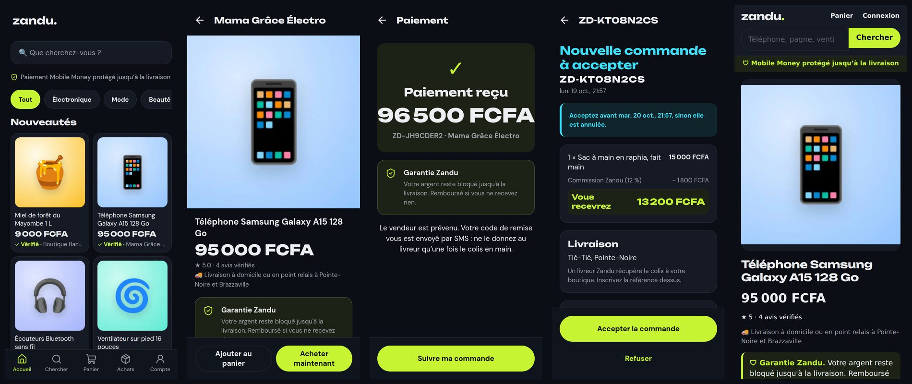
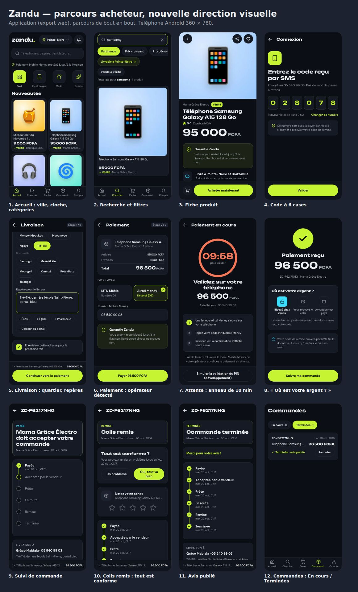
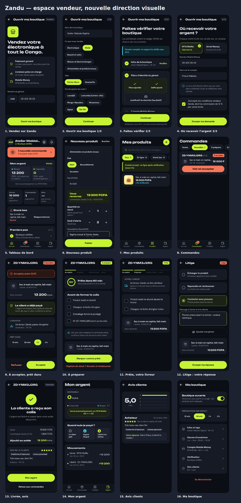
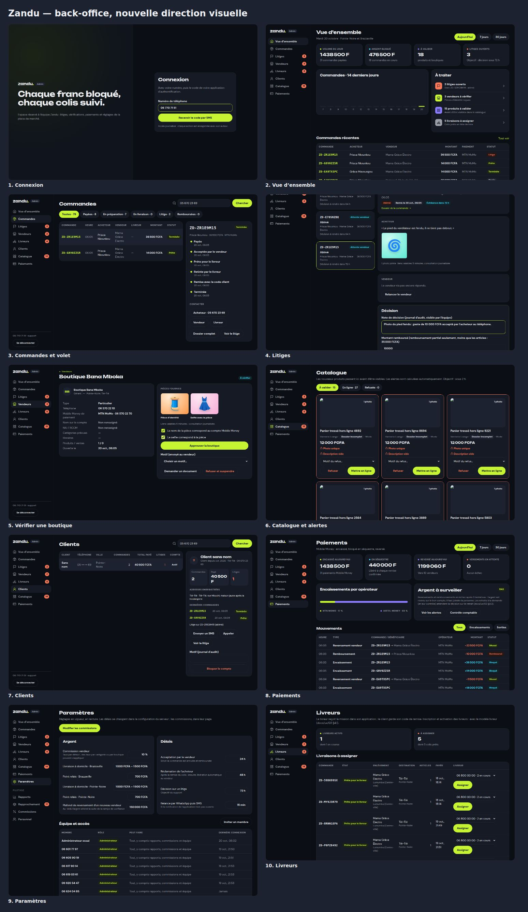
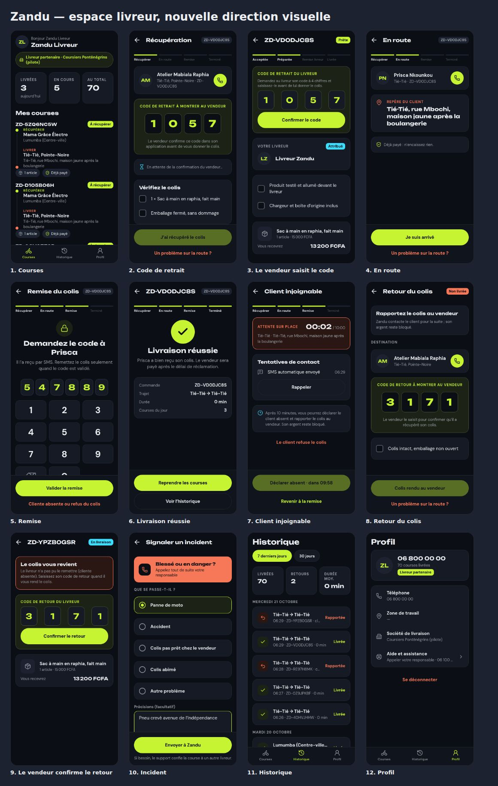
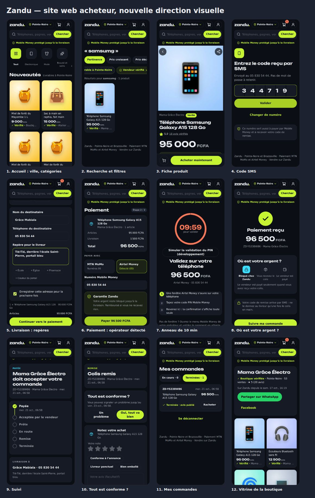

# Nouvelle direction visuelle — analyse et plan de passage

**Source** : quatre maquettes « directions UI » reçues le 19 octobre 2026 (acheteur 15 écrans,
vendeur 19, livreur 17, back-office 11). Elles remplacent la charte de
[01-principes-experience.md §3](01-principes-experience.md) (orange sur fond clair). Ce document
dit ce qui change, ce qui demande des décisions, et dans quel ordre on l'applique.

## 1. Fondations relevées sur les maquettes

Les PDF sont des images : les couleurs ci-dessous sont mesurées sur les pixels, les polices sont à
confirmer avec la designer (fichier Figma ou noms des polices).

| Rôle                                              | Valeur                            | Usage dans les maquettes                                                 |
| ------------------------------------------------- | --------------------------------- | ------------------------------------------------------------------------ |
| Fond                                              | `#0B0E15`                         | tout l'écran, thème sombre unique                                        |
| Fond des barres (bas d'écran, barre d'onglets)    | `#10141D`                         | zone du bouton principal, onglets                                        |
| Surface (cartes)                                  | `#161A25`                         | cartes, champs, puces                                                    |
| Surface relevée / bordure                         | `#1C2230` / `#232832`             | vignettes produit, contours                                              |
| Texte / secondaire / discret                      | `#ECEEF1` / `#9B9FA7` / `#585D65` |                                                                          |
| **Citron** (marque, action principale, confiance) | `#C6F432`                         | boutons, « Vérifié », Garantie Zandu, montants disponibles, onglet actif |
| Cyan (argent bloqué, en route)                    | `#3BDFFD`                         | « Bloqué », « En livraison », points d'information                       |
| Corail (urgent, problème)                         | `#F77858`                         | « À accepter », ventes flash, « Un problème », suspension                |
| Violet (secondaire des graphiques)                | `#8B7BFF`                         | commissions, Airtel Money, rôle Finance                                  |

- **Titres** : linéale très large et grasse (type _Unbounded_ ou _Archivo Expanded_) ; **texte** :
  linéale géométrique (type _DM Sans_). Montants en chiffres larges, « FCFA » en petit.
- Rayons : cartes ≈ 16 px, champs ≈ 12 px, boutons et puces en pilule. Bouton principal citron,
  pleine largeur, posé en bas d'écran (règle du pouce conservée).
- Icônes au trait fin (type Lucide) à la place des émojis actuels.
- Halo citron flou derrière les en-têtes de réussite et les écrans d'accueil.

## 2. Ce qui ne change pas (et que les maquettes respectent)

Paiement bloqué jusqu'à la livraison (« Où est votre argent ? »), code de remise par SMS, connexion
sans mot de passe pour acheteurs/vendeurs/livreurs, MTN MoMo / Airtel Money avec détection du
réseau par le numéro, commandes multi-vendeurs livrées séparément, repère pour le livreur, litige
avec photo et réponse sous 48 h, back-office journalisé.

## 3. Écart avec l'existant, parcours par parcours

Légende : 🎨 restylage seul · 🧩 petite fonction nouvelle (API + écran, sans décision) ·
⚠️ demande une décision du fondateur ou une technologie nouvelle (§4).

### Acheteur (15 écrans)

| Écran                     | Existe ? | Écart                                                                                                                               |
| ------------------------- | -------- | ----------------------------------------------------------------------------------------------------------------------------------- |
| Accueil                   | oui      | 🎨 · 🧩 choix de la ville · ⚠️ bannières et **ventes flash** (prix barré, compte à rebours, stock restant) · ⚠️ recherche par photo |
| Recherche                 | oui      | 🎨 · 🧩 filtres « Livrable à … », « Vendeur vérifié »                                                                               |
| Fiche produit             | oui      | 🎨 · 🧩 favoris, partage · ⚠️ **variantes** (couleur)                                                                               |
| Panier                    | oui      | 🎨 (déjà groupé par vendeur)                                                                                                        |
| Connexion (code)          | oui      | 🎨 6 cases séparées, compte à rebours de renvoi                                                                                     |
| Livraison                 | oui      | 🎨 · 🧩 puces de repère (« + École »…), adresse enregistrée                                                                         |
| Paiement / attente / reçu | oui      | 🎨 anneau de 10 min, « Où est votre argent ? » en trois étapes                                                                      |
| Suivi de commande         | oui      | 🎨 frise · ⚠️ « Voir le livreur sur la carte »                                                                                      |
| Livreur en route          | non      | ⚠️ **carte et position du livreur en direct**, appel et message au livreur                                                          |
| Colis remis + avis        | oui      | 🎨 · 🧩 étiquettes d'avis (« Conforme à l'annonce », « Livreur ponctuel »), note du livreur                                         |
| Mes commandes             | oui      | 🎨 · 🧩 « En cours / Terminées », « Racheter »                                                                                      |
| Notifications             | non      | 🧩 centre de notifications (la table `notifications` existe) · ⚠️ onglet « Offres » (marketing)                                     |
| Signaler un problème      | oui      | 🎨                                                                                                                                  |

### Vendeur (19 écrans)

| Écran                                      | Existe ?  | Écart                                                                                                                  |
| ------------------------------------------ | --------- | ---------------------------------------------------------------------------------------------------------------------- |
| Accueil vendeur + ouverture en 3 étapes    | en partie | 🎨 · 🧩 logo, catégories vendues, lieu de retrait, horaires, nom du titulaire Mobile Money, acceptation des conditions |
| Boutique vérifiée + premiers pas           | non       | 🧩                                                                                                                     |
| Tableau de bord                            | oui       | 🎨 · 🧩 ventes du jour, note, alerte de stock bas · ⚠️ bouton **« Retirer »**                                          |
| Nouveau produit                            | oui       | 🎨 · 🧩 **état** (neuf / reconditionné / occasion), brouillon, seuil d'alerte de stock · ⚠️ prix barré                 |
| Mes produits                               | oui       | 🎨 · 🧩 interrupteur « en ligne / masqué », filtres, recherche                                                         |
| Commandes + accepter                       | oui       | 🎨 · 🧩 « Prêt dans 15 min / 30 min / 1 h / 2 h » · ⚠️ **délai d'acceptation** (10 min à l'écran, 24 h aujourd'hui)    |
| Préparer (liste « avant de fermer »)       | non       | 🧩 liste de contrôle côté téléphone                                                                                    |
| Remise au livreur avec **code de retrait** | non       | ⚠️ nouveau code à 4 chiffres livreur → vendeur                                                                         |
| Livrée (commission affichée)               | en partie | 🎨                                                                                                                     |
| Retour (cliente absente, code de retour)   | non       | ⚠️ nouveau parcours « retour au vendeur »                                                                              |
| Litige (réponse du vendeur)                | non       | 🧩 échanger / reprendre et rembourser / contester avec preuves                                                         |
| Avis clients + réponse                     | non       | 🧩                                                                                                                     |
| Mon argent + Retirer                       | en partie | 🎨 · ⚠️ **retrait à la demande** (aujourd'hui : reversement automatique)                                               |
| Ma boutique                                | non       | 🧩 boutique ouverte/fermée (congés), préparation par défaut, horaires, villes livrées                                  |

### Livreur (17 écrans)

Aujourd'hui, l'application livreur se limite aux missions assignées par le support, à la collecte
et au code de remise (décision D15 : les livreurs viennent d'un partenaire). Les maquettes
décrivent un **modèle différent** : inscription libre avec dossier (pièce, permis, carte grise,
photo de la moto), activation par Zandu, bouton **« En ligne »**, **courses proposées** à accepter en
25 secondes, navigation sur carte, code de retrait chez le vendeur, attente chronométrée et cliente
absente, retour au vendeur, incident, **gains par course** retirés vers Mobile Money, historique et
ponctualité. 🎨 pour les écrans existants ; ⚠️ pour tout le reste (§4.1).

### Back-office (11 écrans, ordinateur)

| Écran          | Existe ?  | Écart                                                                                              |
| -------------- | --------- | -------------------------------------------------------------------------------------------------- |
| Connexion      | oui       | ⚠️ e-mail + mot de passe + code SMS à l'écran ; aujourd'hui téléphone + SMS + application TOTP     |
| Vue d'ensemble | en partie | 🎨 · 🧩 « À traiter », graphique 14 jours (les rapports existent)                                  |
| Commandes      | oui       | 🎨 tableau + volet de détail · 🧩 réassigner, annuler et rembourser                                |
| Litiges        | oui       | 🎨 · 🧩 « Relancer le vendeur », « Organiser un retour »                                           |
| Vendeurs       | oui       | 🎨 · 🧩 cases de contrôle (nom = compte MoMo), « Demander un document »                            |
| Livreurs       | en partie | ⚠️ dépend du modèle livreur                                                                        |
| Clients        | non       | 🧩 liste, fiche, envoyer un SMS, bloquer le compte                                                 |
| Catalogue      | oui       | 🎨 · 🧩 alertes calculées (« prix très bas pour la catégorie », « photo unique »)                  |
| Paiements      | en partie | 🎨 · 🧩 encaissements par opérateur, mouvements · ⚠️ « retrait à contrôler » (dépend des retraits) |
| Promotions     | non       | ⚠️ bannières et ventes flash                                                                       |
| Paramètres     | en partie | 🧩 réglages modifiables à l'écran (aujourd'hui variables d'environnement) · ⚠️ rôle **Finance**    |

La page **Rapprochement** (contrôle de caisse quotidien) et **Personnel** existent mais ne figurent
pas dans les maquettes : on les garde, restylées, dans le menu (Paiements → Rapprochement,
Paramètres → Équipe et accès).

## 4. Retours techniques et décisions

### 4.1 Modèle livreur (le plus gros changement)

Les maquettes supposent des livreurs indépendants, inscrits dans l'application et payés à la
course par Zandu. Cela demande : dossier et activation des livreurs, **attribution automatique**
(proposer la course au livreur en ligne le plus proche, relancer au suivant après 25 s), **position
GPS** des livreurs, gains par course dans le grand livre (compte « livreurs à payer ») et leurs
retraits. C'est une décision de modèle économique (D15) avant d'être une décision technique :
payer chaque livreur, c'est aussi des obligations (contrats, assurance).

**Recommandation** : au lancement, garder l'attribution par le support et les livreurs du
partenaire, avec les **écrans restylés** des maquettes (mission, code de retrait, remise, cliente
absente, retour) ; ajouter « En ligne » et les courses proposées en V2, quand le volume le justifie.

### 4.2 Cartes et suivi en direct

« Voir le livreur sur la carte », la navigation du livreur et le temps d'arrivée demandent :

- une **bibliothèque de cartes** : MapLibre (libre) avec des tuiles OpenStreetMap hébergées ou
  payantes (MapTiler, Stadia ; ≈ 0 à 50 €/mois au début), plutôt que Google Maps (plus cher, compte
  de facturation). Ajout à l'application : `@maplibre/maplibre-react-native` (module natif, la
  construction de l'APK le prend en charge) ;
- la **position du livreur** envoyée toutes les 10 à 20 s pendant une course (`expo-location`,
  autorisation de localisation en arrière-plan, consommation de batterie et de données à mesurer
  en 3G) et relayée à l'acheteur (interrogation régulière au début, WebSocket plus tard) ;
- des cartes de Pointe-Noire et Brazzaville suffisamment détaillées : à vérifier sur
  OpenStreetMap, quartier par quartier ; le **repère écrit** (« derrière l'école Saint-Pierre »)
  reste la référence.

**Recommandation** : pas de carte au lancement ; afficher l'étape et l'heure prévue (déjà possible)
et le bouton d'appel. Carte en V2 avec le modèle livreur.

### 4.3 Retrait à la demande de l'argent du vendeur

Aujourd'hui l'argent disponible est reversé automatiquement (avec un plafond pour les nouveaux
vendeurs). Le bouton « Retirer » demande une route de retrait avec **code SMS de confirmation**, un
seuil de contrôle par le back-office (« Retrait à contrôler ») et les frais éventuels de
l'agrégateur (D1). Le grand livre, l'idempotence et le rapprochement savent déjà faire : c'est un
sprint, sans technologie nouvelle. **Décision** : retrait à la demande seul, ou automatique +
à la demande ?

### 4.4 Délai d'acceptation du vendeur

Les maquettes montrent 10 minutes (compte à rebours « Acceptez avant 14:40 », réglage du
back-office). Aujourd'hui : 24 h. 10 minutes impose au vendeur d'être joignable en permanence (les
notifications que l'on vient d'ajouter aident) ; une commande non acceptée est annulée et
remboursée. **Recommandation** : rendre le délai réglable (Paramètres), démarrer à 2 h pendant les
heures d'ouverture de la boutique, et descendre si les vendeurs suivent.

### 4.5 Connexion au back-office

Les maquettes montrent e-mail + mot de passe + code SMS. Aujourd'hui : numéro + code SMS + code
d'une application d'authentification (TOTP), plus sûr : le code SMS est vulnérable au vol de carte
SIM, courant dans la région. **Recommandation** : garder le dispositif actuel avec l'apparence de
la maquette (même mise en page, champs adaptés). Si l'e-mail est souhaité, e-mail + mot de passe +
TOTP, pas SMS.

### 4.6 Promotions, ventes flash, variantes, prix barré

Nouveaux objets en base (bannières programmées, ventes flash avec prix, quantité, période et accord
du vendeur, variantes de produit avec leur stock) et règles de prix au moment de la commande (le
prix flash doit être celui payé, jamais un prix affiché seulement). Pas de technologie nouvelle.
**Recommandation** : après le lancement ; les variantes d'abord (demandées par les vendeurs de
téléphones), les ventes flash ensuite.

### 4.7 Recherche par photo

L'icône d'appareil photo dans la recherche suppose une reconnaissance d'image (service payant ou
modèle à héberger). **Recommandation** : retirer l'icône pour l'instant.

### 4.8 Thème sombre et polices

- Thème sombre unique : il économise la batterie sur les écrans OLED, mais la plupart des
  téléphones d'entrée de gamme ont un écran LCD, et la lisibilité **en plein soleil** est moins
  bonne. À vérifier sur 2-3 téléphones réels dès la recette ; les contrastes mesurés (texte
  `#ECEEF1` sur `#0B0E15`, citron sur fond sombre) sont largement au-dessus du niveau AA.
- Deux polices ajoutent du poids : ≈ 150 Ko dans l'APK (sans importance) ; sur le **site web**,
  2 fichiers WOFF2 réduits aux caractères latins et à 2 graisses, ≈ 60 Ko, chargés sans bloquer
  l'affichage, pour rester dans le budget 3G (ADR-0012). Les PDF ne contiennent pas les polices :
  il faut leurs noms (ou le fichier Figma) et vérifier leur licence (Google Fonts : libre).
- Icônes : `lucide-react-native` + `react-native-svg` dans l'application, `lucide-react` (icônes
  importées une à une) sur le site et le back-office.
- Aucune autre technologie ne change : Expo, Next.js, l'API et la base restent les mêmes. Les
  couleurs sont déjà centralisées (`apps/mobile/src/theme.ts`, variables CSS du site et du
  back-office) : le passage se fait par petites étapes, écran par écran, sans casser les parcours
  automatisés.

## 5. Plan de passage

| Étape | Contenu                                                                                                                                                                                                                   | Décision nécessaire |
| ----- | ------------------------------------------------------------------------------------------------------------------------------------------------------------------------------------------------------------------------- | ------------------- |
| 1     | **Fondations** : couleurs, polices, rayons, icônes dans un paquet partagé `packages/design` ; composants de base (bouton, champ, carte, puce, badge, frise, code à 6 cases) dans l'application, le site et le back-office | noms des polices    |
| 2     | **Acheteur** restylé écran par écran (application + site), avec les 🧩 : ville, filtres, favoris, puces de repère, adresse enregistrée, étiquettes d'avis, « Racheter », centre de notifications                          | —                   |
| 3     | **Vendeur** : ouverture en 3 étapes, tableau de bord, produits (état, interrupteur), commandes (prêt dans…, liste de contrôle), litige côté vendeur, avis et réponses, Ma boutique                                        | §4.4                |
| 4     | **Back-office** : menu latéral sombre, vue d'ensemble, commandes avec volet, clients, paiements, catalogue en cartes, paramètres modifiables                                                                              | §4.5                |
| 5     | **Livreur** : écrans restylés du modèle actuel (mission, code de retrait, remise, cliente absente, retour, incident)                                                                                                      | §4.1                |
| 6     | Retrait à la demande · délai d'acceptation réglable                                                                                                                                                                       | §4.3, §4.4          |
| V2    | Livreurs indépendants et courses proposées · carte et suivi en direct · ventes flash, bannières, variantes · rôle Finance                                                                                                 | §4.1, §4.2, §4.6    |

Chaque étape garde les parcours de bout en bout verts et ajoute des captures comparées aux
maquettes.

## 6. Étape 1 — fondations (✅ faite)

- **`packages/design`** : couleurs, espacements, rayons, tailles et polices en un seul endroit.
  L'application lit `src/tokens.ts` ; le site et le back-office lisent `tokens.css`, généré à
  partir de lui (`pnpm --filter @zandu/design generate`, vérifié par la CI).
- **Application** : thème sombre partout (en-têtes, onglets, barres du bas), polices Unbounded et
  DM Sans comprises dans l'application, icônes Lucide dans la barre d'onglets et l'encart
  « Garantie Zandu ». Le composant `src/ui/Text.tsx` choisit la police selon la graisse
  (sur Android, chaque graisse est une police à part) et met le texte en clair par défaut.
  Bouton principal citron en pilule, champs avec contour citron à la saisie, puces en pilule,
  cartes à bord fin, code à 6 cases en citron.
- **Site** : mêmes couleurs ; la police des titres (Unbounded, 21 Ko) se charge **après** la page
  et vient ensuite du cache du téléphone ; le texte courant garde la police du téléphone. Fiche
  produit en 3G : 163 Ko, page utilisable en 2,3-2,4 s (budget 2,5 s ; 155 Ko et 2,3 s avant).
- **Back-office** : menu latéral sombre, logo « zandu. », tableaux, onglets et boutons du thème ;
  DM Sans et Unbounded (ordinateurs du support, pas de contrainte 3G).
- Polices **provisoires** : un seul endroit à changer (`fontFamily` et les fichiers chargés) quand
  la designer confirme les siennes.
- Restent pour les étapes suivantes : les émojis dans les écrans, les montants avec « FCFA » en
  petit, les couleurs propres à chaque écran (« Refuser » en corail…), et les petites fonctions
  listées au §3.

## 7. Étape 2 — parcours acheteur dans l'application (✅ faite)

Tous les écrans acheteur de l'application suivent les maquettes ; les trois parcours de bout en
bout de l'application (acheteur, vendeur et livreur, hors connexion) passent.

- **Accueil** : logo, choix de la ville (Pointe-Noire ou Brazzaville, gardé sur le téléphone ;
  l'accueil ne montre que les produits livrables dans cette ville), cloche avec point rouge,
  catégories en tuiles à icônes.
- **Recherche** : filtres « Livrable à … » et « Vendeur vérifié » (nouveau paramètre `verified`
  de `GET /v1/products`).
- **Fiche produit** : photo pleine largeur avec retour, partage et favori par-dessus, prix en
  grand avec « FCFA » en petit, ancien prix barré s'il existe, étiquettes des avis, bouton panier
  rond et « Acheter maintenant ». Les **favoris** restent sur le téléphone (rien n'est envoyé au
  serveur) et sont visibles dans « Compte », même sans réseau.
- **Connexion** : indicatif +242, code en 6 cases, compte à rebours avant de renvoyer le code.
- **Livraison** : « Étape 1 / 2 », mode en cartes, quartier en puces, puces de repère
  (« + École »…), case « Enregistrer cette adresse ».
- **Paiement** : opérateur deviné d'après le numéro (« Détecté »), anneau de 10 min pendant la
  validation du PIN, trois étapes expliquées, puis « Où est votre argent ? » en trois temps.
- **Suivi, remise et avis** : grand encart d'état, frise à points citron, « Tout est conforme ? »,
  avis avec étoiles et **étiquettes** (« Conforme à l'annonce », « Livreur ponctuel », « Bien
  emballé » ; colonne `reviews.tags`, migration 0008).
- **Commandes** : « En cours / Terminées », barre d'avancement, « Racheter » (remet les articles
  au panier au prix du moment).
- **Notifications** : nouveau centre (`GET /v1/me/notifications`, `POST /v1/me/notifications/seen`)
  construit sur les messages déjà envoyés ; codes de connexion et alertes internes jamais montrés,
  code de remise masqué. Gardé hors connexion avec les autres données du compte.
- **Litige** : montant bloqué rappelé, motifs en boutons radio, photos ajoutées après l'ouverture.
- **Compte** : favoris, accès vendeur et livreur avec icônes, « Se déconnecter ».

Écarts volontaires avec les maquettes :

- Délai de réponse au litige affiché « sous 72 h » (le délai réel), pas 48 h.
- Pas de carte du livreur, ni de ventes flash, bannières, variantes ou onglet « Offres » : ils
  attendent les décisions du §4.
- Le **site** garde pour l'instant les couleurs de l'étape 1 ; ses écrans acheteur seront repris
  sur le même modèle, en restant dans le budget 3G.

## 8. Étape 3 — espace vendeur dans l'application (✅ faite)

Les écrans vendeur suivent les maquettes. Le parcours de bout en bout vendeur et livreur passe
par tous ces écrans, litige compris ; les parcours acheteur et hors connexion passent toujours.

- **Ouverture en 3 étapes** : présentation, puis (1) nom, ce que vous vendez, lieu de retrait,
  horaires ; (2) pièce d'identité et selfie ; (3) compte Mobile Money, nom du titulaire,
  acceptation des conditions avec le taux de commission. Le compte Mobile Money vient désormais
  à l'étape 3 : d'ici là, le numéro du gérant est retenu.
- **Onglets vendeur** : Accueil, Commandes (pastille des commandes à accepter), Produits, Argent.
- **Tableau de bord** : nouvelle commande en corail avec l'heure limite, argent bloqué et
  disponible, ventes et commandes du jour (heure de Brazzaville), note, alerte de stock bas,
  « Premiers pas » tant que la boutique n'est pas prête.
- **Produits** : recherche, filtres (Tous, En ligne, Stock bas, Masqués), interrupteur
  « en ligne / masqué » ; nouveau produit avec **état** (neuf, reconditionné, occasion, affiché
  sur la fiche acheteur) et **seuil d'alerte** de stock.
- **Commandes** : filtres, « Voir et accepter », « Marquer comme prête » directement dans la liste.
- **Une commande, un écran par statut** : à accepter (« Prêt dans 15 min / 30 min / 1 h / 2 h »,
  promesse enregistrée), à préparer (temps restant, liste « Avant de fermer le colis »,
  « Rupture de stock ? Annuler et rembourser » — désormais permis en préparation), prête (livreur
  attribué), livrée (vente, commission, solde, avis de la cliente), **litige** (échanger,
  reprendre et rembourser, ou contester avec photos ; le support voit la réponse avant de trancher).
- **Avis clients** : note, répartition, réponse publique du vendeur, visible sur la fiche produit.
- **Mon argent** : disponible et bloqué, « Quand suis-je payé ? », mouvements (bloqué, libéré, versé).
- **Ma boutique** : boutique ouverte ou **en congé** (produits retirés du catalogue, achat
  refusé), préparation par défaut, infos et horaires, compte Mobile Money, vérification, avis.

API : migration 0009 ; routes `PATCH /v1/seller/shop`, `GET /v1/seller/dashboard`,
`GET /v1/seller/reviews`, `POST /v1/seller/reviews/{id}/reply`,
`POST /v1/seller/orders/{id}/dispute-response` et `…/dispute-evidence` ; contrat et client à jour.

Écarts volontaires avec les maquettes (décisions du §4) :

- **Pas de bouton « Retirer »** : l'argent reste versé automatiquement (§4.3) ; l'écran le dit.
- **Pas de code de retrait livreur → vendeur, ni de parcours « retour au vendeur »** : ils
  dépendent du modèle livreur (§4.1).
- **Délai d'acceptation inchangé (24 h)** en attendant le §4.4 ; l'écran affiche l'heure limite.
- **Logo de boutique et villes livrées** : pas encore (stockage du logo et zones par boutique à
  prévoir) ; les initiales servent de logo.
- Le stock restant après la commande et la photo des articles ne sont pas encore dans la vue
  vendeur d'une commande (icône à la place).

## 9. Étape 4 — back-office (✅ faite)

Le back-office suit les maquettes « Admin ». Les quatre parcours de bout en bout (support,
rapports, personnel, rapprochement) passent par les nouveaux écrans.

- **Menu latéral** à icônes : Vue d'ensemble, Commandes, Litiges, Vendeurs, Livreurs, Clients,
  Catalogue, Paiements, Paramètres (administrateurs) ; pastilles du nombre de cas à traiter.
  Rapports, Rapprochement, Commissions et Personnel restent groupés sous « Pilotage ».
- **Connexion** en deux colonnes ; toujours numéro + SMS + application d'authentification (§4.5).
- **Vue d'ensemble** : période (aujourd'hui, 7 jours, 30 jours), volume, argent bloqué, à valider,
  litiges ouverts, commandes sur 14 jours, liste « À traiter », commandes récentes
  (`GET /v1/support/dashboard`). La commission n'est montrée qu'aux administrateurs.
- **Commandes** : onglets avec compteurs, recherche par référence ou téléphone, volet à droite
  (frise, contacts, « Dossier complet », annulation).
- **Litiges** : liste à gauche, dossier à droite (ce que dit l'acheteur, réponse du vendeur ou
  « Relancer le vendeur », décision motivée : rembourser, partiel, libérer).
- **Vendeurs** : onglets avec compteurs ; vérification avec pièces en vignettes, deux contrôles
  obligatoires avant « Approuver la boutique », motifs types pour « Demander un document » ou
  « Refuser et suspendre ».
- **Catalogue** en cartes, alertes calculées (prix très bas pour la catégorie, photo unique,
  description vide), motif de refus choisi dans une liste.
- **Clients** (nouveau) : recherche par nom ou numéro, fiche (commandes, payé, litiges, adresses),
  SMS, appel, blocage motivé qui ferme les sessions.
- **Paiements** (nouveau) : encaissé, en séquestre, reversé, versements en attente, répartition
  par opérateur, mouvements ; liens vers Alertes, Contrôle comptable et Rapprochement.
- **Paramètres** (nouveau) : commission par défaut, tarifs de livraison, plafond des nouveaux
  vendeurs, délais ; équipe et accès.
- **Livreurs** : indicateurs et livraisons à assigner.

API : routes `GET /v1/support/dashboard`, `/payments`, `/customers` (et fiche, blocage),
`POST /v1/support/disputes/{id}/remind-seller`, `GET /v1/admin/settings` ; compteurs et filtres
ajoutés aux listes des commandes, litiges, vendeurs et produits ; contrat et client à jour.

Écarts volontaires avec les maquettes (décisions du §4) :

- **Paramètres en lecture seule** : le réglage à l'écran viendra avec le délai d'acceptation (§4.4).
- **Pas de carte « Retrait à contrôler »** (§4.3) ni de **Promotions** (§4.6).
- **Livreurs** limité à l'assignation des livraisons (§4.1).
- « Organiser un retour » remplacé par **« Remboursement partiel »** tant qu'il n'y a pas de
  parcours de retour (§4.1).
- Comptabilité et Alertes restent des pages à part, accessibles depuis Paiements.

## 10. Étape 5 — espace livreur dans l'application (✅ faite)

Les écrans livreur suivent la maquette « Livreur », **dans le modèle actuel** (§4.1) : livreurs
des sociétés partenaires, courses attribuées par le support. Le parcours de bout en bout vendeur
et livreur passe par tous ces écrans : une livraison réussie, un client absent avec retour au
vendeur, un incident. Les autres parcours (acheteur, hors connexion, site, back-office) passent
toujours.

- **Onglets** : Courses, Historique, Profil.
- **Courses** : bonjour, société partenaire, livrées aujourd'hui, en cours, total ; chaque course
  en carte « Récupérer → Livrer » avec le repère, le nombre d'articles et « Déjà payé » ; liste
  « Avant de partir ».
- **Une course en 4 étapes** (Récupérer, En route, Remise, Terminé) :
  - **Récupérer** : boutique avec bouton d'appel, **code de retrait à 4 chiffres** à montrer au
    vendeur, qui le saisit dans son application (écran « Prête ») ; le livreur coche les articles
    et l'emballage, puis « J'ai récupéré le colis » (refusé tant que le vendeur n'a pas confirmé) ;
  - **En route** : client avec bouton d'appel, repère en grand, « Je suis arrivé » (un SMS
    prévient le client) ;
  - **Remise** : « Demandez le code à Prisca », pavé géant, « Valider la remise » ;
  - **Terminé** : livraison réussie, trajet, durée, courses du jour.
- **Client injoignable** : attente chronométrée (10 min, `RIDER_ABSENT_WAIT_MINUTES`), tentatives
  de contact (SMS automatique, appels du livreur), « Déclarer absent » une fois l'attente passée,
  ou « Le client refuse le colis » avec un motif.
- **Retour du colis** : code de retour à 4 chiffres, que le vendeur saisit en reprenant son colis
  (écran « Le colis vous revient ») ; « Colis rendu au vendeur » ouvre un litige : l'argent reste
  bloqué et le support décide de la suite.
- **Signaler un incident** : panne, accident, colis pas prêt, colis abîmé, autre ; précisions ;
  appel direct au responsable de la société. Le support est prévenu.
- **Historique** : 7 ou 30 jours, livrées, retours, durée moyenne, courses par jour.
- **Profil** : téléphone, zone, société de livraison, aide, déconnexion.
- **Back-office, Livreurs** : « Incidents et retours » des 7 derniers jours, avec « Réassigner »
  tant que le colis n'est pas pris.

API : migration 0010 (statut `returning`, codes de retrait et de retour, arrivée, journal
`delivery_events`) ; routes `GET /v1/rider/me`, `GET /v1/rider/history`,
`POST /v1/rider/deliveries/{id}/arrived`, `…/contact-attempt`, `…/return`, `…/returned`,
`…/incident`, `POST /v1/seller/orders/{id}/rider-pickup` et `…/rider-return`,
`GET /v1/support/delivery-events` ; les routes du livreur sont regroupées dans
`orders/rider.routes.ts` ; contrat et client à jour.

Écarts volontaires avec la maquette (décisions du §4) :

- **Pas d'inscription libre, de bouton « En ligne », de courses proposées en 25 s ni d'onglet
  Gains** : le livreur est payé par sa société partenaire (D15, §4.1).
- **Pas de carte ni d'itinéraire** (§4.2) : le repère écrit et le bouton d'appel restent la
  référence.
- **Pas de photo du colis** à la récupération : la liste de contrôle en tient lieu pour l'instant.
- **« Appel par Zandu »** remplacé par l'appel au responsable de la société ; **nouvelle
  livraison après un retour** : décidée par le support hors application, pas encore de
  « reprogrammer » à l'écran.
- Pas de note du livreur ni de ponctualité : la note des livreurs n'existe pas encore ; la durée
  moyenne la remplace.

## 11. Écrans acheteur du site web (✅ faits)

Le site suit maintenant les mêmes maquettes acheteur que l'application (§7), **sans JavaScript de
plus sur les pages publiques** : tout est en HTML et en CSS, rendu par le serveur. La fiche
produit en 3G passe de 163 à 169 Ko, avec 144 Ko de JavaScript (budget 170), et reste
utilisable en 2,4 s (budget 2,5 s). Le parcours de bout en bout du site passe.

- **En-tête** : logo, **choix de la ville** (Pointe-Noire ou Brazzaville, gardé un an dans un
  cookie par un simple lien `/ville?v=…`), panier et compte en icônes, recherche dessous.
- **Accueil** : catégories en tuiles à icônes (mêmes icônes que l'application), nouveautés
  **livrables dans la ville choisie**.
- **Recherche** : tri, filtres « Livrable à {ville} » et « Vendeur vérifié », nombre de résultats.
- **Vignettes et prix** : « 95 000 FCFA » avec la devise en petit, ancien prix barré s'il existe,
  « ✓ Vérifié · boutique ».
- **Fiche produit** : photo pleine largeur avec retour et partage par-dessus, boutique et badge
  « Vérifié », note et lien vers les avis, prix en grand, encart « Garantie Zandu », livraison,
  **barre d'achat fixée en bas** (panier rond, « Acheter maintenant »), avis avec étiquettes et
  réponse du vendeur.
- **Connexion** : indicatif +242, code dessiné en 6 cases (un seul vrai champ : le remplissage
  automatique du SMS marche toujours).
- **Livraison** (« Étape 1 / 2 ») : mode en cartes, quartiers en puces par ville, repères ajoutés
  d'un toucher (« + École »…), « Enregistrer cette adresse ».
- **Paiement** (« Étape 2 / 2 ») : opérateurs en cartes avec « Détecté (05) », anneau de
  10 minutes pendant la validation du PIN, trois étapes ; puis « Où est votre argent ? ».
- **Suivi** : encart d'état (« Mama Grâce Électro doit accepter votre commande »), frise à points
  citron, « Tout est conforme ? » avec « Un problème » / « Oui, tout va bien », **note de l'achat
  avec étoiles et étiquettes** (nouveau sur le site).
- **Mes commandes** : « En cours / Terminées », barre d'avancement, **« Racheter »** (remet les
  articles au panier au prix du moment).

Écarts volontaires : pas de cloche ni de centre de notifications sur le site (l'acheteur reçoit
ses SMS et WhatsApp) ; pas de favoris sur le site (ils restent dans l'application).

## 12. Délai d'acceptation réglable (✅ fait, valeur à décider — §4.4)

Le délai laissé au vendeur pour accepter une commande payée se règle maintenant dans
**Paramètres** du back-office (administrateurs), parmi des valeurs fixes : 10 min, 30 min, 1 h,
2 h, 4 h, 12 h, 24 h. Chaque changement demande un motif et va au journal d'audit.

- Il s'applique aux **commandes payées après le changement** : les délais déjà donnés aux
  vendeurs ne bougent pas. Passé le délai, la commande est annulée et l'acheteur remboursé,
  comme avant.
- Tant que personne ne l'a réglé, c'est la valeur du serveur (`SELLER_ACCEPT_HOURS`, 24 h).
  **Rien n'a été changé** : le choix de la valeur reste au fondateur (recommandation : 2 h).
- Le vendeur voit déjà l'heure limite partout (notification, tableau de bord, écran « À
  accepter ») : rien à changer dans l'application.
- API : `PATCH /v1/admin/settings` ; la table `platform_settings` (créée en 0001, jamais
  utilisée jusqu'ici) n'accepte que les clés connues (migration 0011).

Ce qui n'est pas fait : un délai qui ne court que **pendant les heures d'ouverture** de la
boutique. Les horaires sont aujourd'hui un texte libre (« Lun – Sam · 08:00 – 18:00 ») ; il
faudrait des horaires structurés par jour.

## 13. Horaires d'ouverture jour par jour (✅ faits)

- **Application vendeur** : « Ma boutique → Heures d'ouverture » ouvre un écran jour par jour
  (ouvert ou fermé, heure d'ouverture et de fermeture, « Mêmes horaires tous les jours
  ouverts »). À l'ouverture de la boutique, le choix rapide (« Lun – Sam · 08:00 – 18:00 »)
  enregistre déjà les 7 jours. Le texte montré aux acheteurs est tiré des horaires
  (« Lun – Ven · 08:00 – 18:00 ; Sam · 08:00 – 13:00 »).
- **Back-office, Paramètres** : case « Ne compter que les heures d'ouverture de la boutique ».
  Exemple : 2 h pour accepter, boutique ouverte de 8 h à 18 h, commande payée à 20 h → à
  accepter avant 10 h le lendemain ; payée le samedi à 17 h 30 → avant 9 h 30 le lundi si le
  dimanche est fermé.
- La case est **décochée** par défaut (rien ne change) ; une boutique qui n'a pas renseigné ses
  horaires jour par jour garde le délai normal.
- Calcul dans le domaine (`addOpenMinutes`, heure de Brazzaville, UTC+1 toute l'année),
  9 tests ; migration 0012 (`seller_profiles.weekly_hours`).
